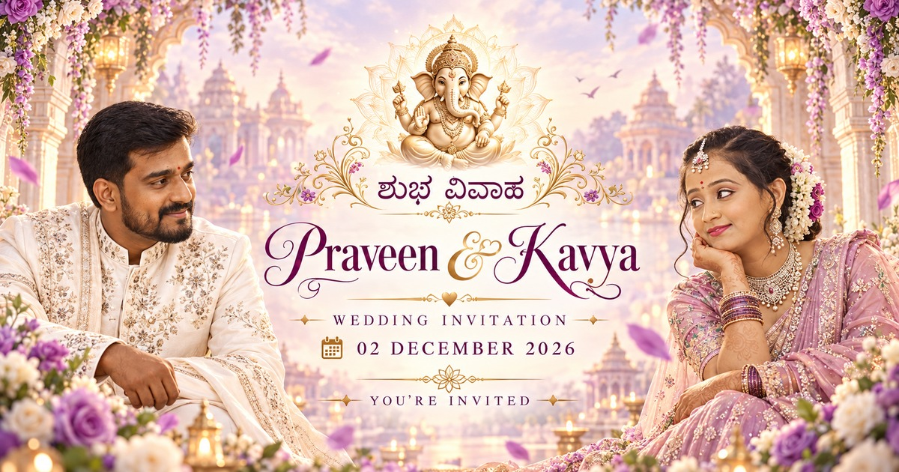

# 💜 Praveen & Kavya — Wedding Invitation

  

  <strong>✨ A Brother’s Special Gift for His Sister ✨</strong>

  <em>Some gifts are bought. Some gifts are made with love. This one was built with code and heart. 💜</em>

  

---

## 💍 About This Project

This is a **digital wedding invitation for Praveen & Kavya**, thoughtfully designed and developed as a special gift from a brother to his sister for one of the most memorable days of her life.

The website brings together elegant wedding design, Kannada and English content, smooth cinematic interactions, family memories, event details, venue directions, music and a premium mobile experience.

> **A small effort from a brother for one of the biggest days in his sister’s life. 💜**

---

## 🌸 Wedding Details

| Celebration | Date & Time |
|---|---|
| 💐 **Reception** | **01 December 2026** |
| 💍 **Muhurtham** | **02 December 2026 — 9:30 AM** |
| 🍽️ **Beegara Oota** | **13 December 2026 — 12:30 PM onwards** |

---

## ✨ Website Highlights

- 💜 Premium lavender, plum, ivory and champagne-gold theme
- 🎞️ Smooth cinematic **50/50 invitation opening**
- 💌 Elegant **P & K wedding seal**
- 🌺 Kannada + English wedding content
- 🎥 Wedding video invitation
- 👫 Meet the Couple section
- 📅 Save the Date timeline
- ⏳ Live wedding countdown
- 💖 Smart wedding-day message
- 🖼️ Our Moments gallery with full-screen lightbox and swipe support
- 📍 Wedding and Beegara Oota venue details
- 🗺️ One-tap Google Maps directions
- 🎵 Background wedding music
- 📲 WhatsApp/social sharing preview
- 💜 Custom `P ♥ K` favicon
- 📱 Fully responsive mobile design
- ✨ Smooth reveal animations and decorative scroll progress
- ♿ Accessibility improvements
- ⚡ Gallery preloading and performance optimizations

---

## 🎨 Design Theme

The website follows a soft, elegant wedding palette:

- 💜 **Lavender**
- 🍇 **Deep Plum**
- 🤍 **Ivory**
- ✨ **Champagne Gold**

The visual style is intentionally romantic and premium, while keeping animations smooth and the content easy to read on mobile devices.

---

## 🛠️ Built With

  
  
  
  

---

## 🌐 Live Wedding Invitation

### 💜 Praveen ♥ Kavya

**02 December 2026**

👉 **[Open the Wedding Invitation](https://karthikg1908.github.io/praveen-weds-kavya/)**

For the best experience, open the invitation on a phone, keep the sound on, tap the wedding seal and enjoy the complete celebration from beginning to end.

---

## 💌 A Note From the Brother

> This project was not created for an assignment.  
> It was not created just for a portfolio.  
>  
> It was created for family.  
>  
> **For my sister.**  
>  
> For a once-in-a-lifetime celebration. 💜

---

## 👨‍💻 Designed & Developed By

  <strong>Karthik G</strong> 
  Brother • Developer • Designer

  <strong>✦ Thoughtfully crafted for my sister’s special day ✦</strong>  
  <code>Made with Love • Memories • Code</code>

---

  <strong>💜 Praveen ♥ Kavya 💜</strong> 
  <strong>02 December 2026</strong>  
  शुभ विवाह • ಶುಭ ವಿವಾಹ  
  <em>A beautiful beginning to forever.</em>

